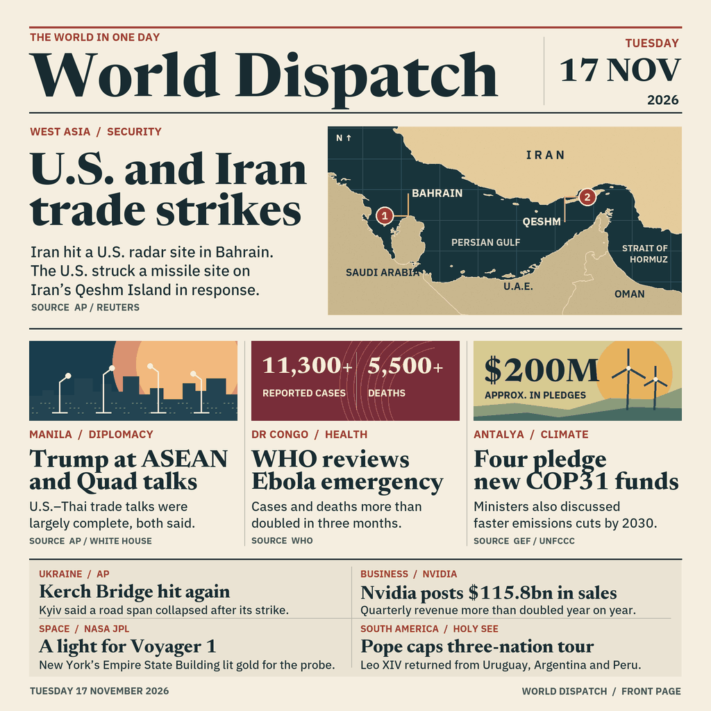

# World Dispatch | 17 November 2026

[](https://make.fun/bounty/news-image-20261117)
[](https://make.fun/bounty/news-image-20261117/leaderboard)
[](https://make.fun/bounty/news-image-20261117)

An original English news front page for Tuesday, 17 November 2026.
The Gulf lead places the day's two reported strikes on one map. Illustrated
stories from Manila, DR Congo and Antalya sit above four short world briefs.
See [SOURCES.md](SOURCES.md) for the dated reports and data credits.



## Run the contest entry

From this repository, with Python 3.13 and no third-party modules:

```sh
python3 -I -S main.py
```

The Make.fun container supplies a writable `/output`. The program reads the
frozen edition alongside `main.py` and writes `/output/entry.png`.
For two local runs into separate directories:

```sh
MAKEFUN_OUTPUT_DIR=out/run1 python3 -I -S main.py
MAKEFUN_OUTPUT_DIR=out/run2 python3 -I -S main.py
sha256sum entry.png out/run1/entry.png out/run2/entry.png
```

## Rebuild the artwork

`draw_edition.py` draws the type, map, illustrations and layout from local
assets. With Pillow 13.0.0 available in an authoring environment:

```sh
python3 draw_edition.py --output out/rebuilt.png
```

The authoring renderer uses Pillow, FreeType and zlib. Use the committed
PNG or the contest entrypoint to reproduce its exact published bytes across
machines with different font and compression library versions. The renderer
does not make network calls. The contest entrypoint does not use Pillow.

Code and original artwork are MIT-licensed. The bundled Newsreader and
IBM Plex Sans fonts use their respective SIL Open Font Licenses in
`assets/`. The map geometry is from public-domain Natural Earth data.
